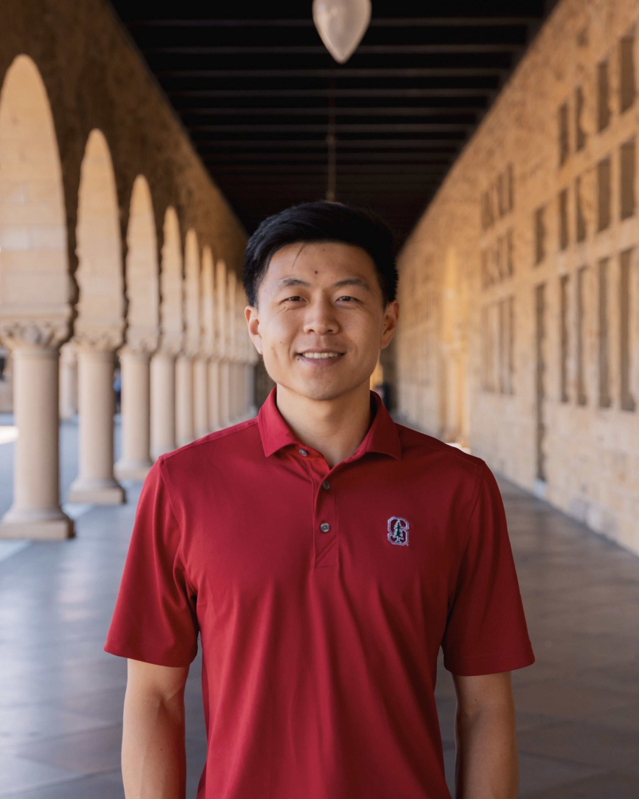

# Overview

Welcome!  This is a notes compilation dedicated to basic and fundamental engineering theory that I find myself needing refreshers on often. 

I got tired of sifting through a decentralized set of textbooks, wikipedia pages, blogs, Paul's Online Math Notes, or Physics Libre Texts, every time I needed to remind myself how to do something simple. 

Voila - *Les Guides pour Les Nuls* ("The Guides for Dummies").  This name was inspired by a notes compilation with similar purpose: [The Matrix Cookbook](https://www2.compute.dtu.dk/pubdb/pubs/3274-full.html).  I figured if I was making my own personal theory cookbook, I'd go one step further and name it in the liking of Escoffier's mother of all actual cookbooks: *Le Guide Culinaire*.  

My notes may be wrong.  These are typeset scratch notes and prone to error.  If you find one, please email me at [seanlin@stanford.edu](mailto:seanlin@stanford.edu).

My notes may be incomplete.  If a section is blank, it is a placeholder for me to fill in later. 

None of my notes, or explanations, are AI-generated. I hope you find them useful :)

## Contents

Content near the front is general.  Content near the back is niche to my domain. 
- MATH
    - [Algebra](algebra)
    - [Geometry and Trigonometry](geom_trig)
    - [Calculus](calculus)
    - [Multivariable](multivariable)
    - [Differential Equations](difeqs)
    - [Linear Algebra](linalg)
    - [Probability and Statistics](prob_stats)
    - [Complex Domain](complexdomain)
- MECHANICS
    - [Classical Dynamics](classical_dynamics)
    - [Fluids](fluids)
    - [Thermodynamics](thermo)
    - [Solid Mechanics](solid_mechanics)
    - [Material Properties](materials)
- ELECTRONICS
    - [Components](components)
    - [Power Electronics](power_electronics)
    - [Signal Processing](signals)
    - [E&M Theory](theory) 
- ALGORITHMS
    - [Least Squares](least_square) *and flavors*
    - [Numerical Methods](numerical_methods) *Euler, Newton, RK4, etc...*
    - [State Estimation](state_estimation) *Kalman Filters, EKFs, UKFs, etc...*
    - [Machine Learning](ML) *RL included*
    - [Optimization](optimization)
- CONTROL THEORY
    - [Linear System Theory](linearsystemtheory) *proof heavy, focus on the setup of a linear feedback system*
    - [PID Control](PID) 
    - [State Space Control](state_space) *practical, focused on the design rules and best practices of a controller*
    - [Modern Control](modern_control) 
- SPACE STUFF
    - [Orbital Basics](orbital_theory)
    - [Common Satellite Coordinate Frames and Systems](orbital_frames)
    - [Transfer Orbits and Manuevers](orbital_maneuvers)
    - [N-Body Theory](n-body)
    - [GPS Theory](GPS)

---

## Notes Philosophy

I care about:

- Theory from first principles
- Balancing rigorous proofs and intuitive understanding
- Emphasizing things that are best to commit to memory (for practical purposes)

[Longer version here](notes_philo)

---

## About the Author

  

    
  

  

    
Knowing my background can put into context how I come to understand things. My qualifications are also provided so you can decide how much to trust my guide.

My name is Sean Lin. I am an aspiring GNC (Guidance, Navigation, and Control) engineer. We design systems that allow air- and spacecraft to:

<ol>
  <li>Determine where they are (Navigation)</li>
  <li>Define the trajectory they want to follow (Guidance)</li>
  <li>Physically execute this trajectory (Control)</li>
</ol>

<strong>Qualifications</strong>

<ul>
  <li>B.S. Mechanical Engineering + EECS (UC Berkeley, 2023)</li>
  <li>M.S. Aeronautics and Astronautics (Stanford, 2026)</li>
  <li>Cumulative Engineering Work Experience: 2 years</li>
  <li>Cumulative Engineering Research Experience: 1 year</li>
</ul>

  

